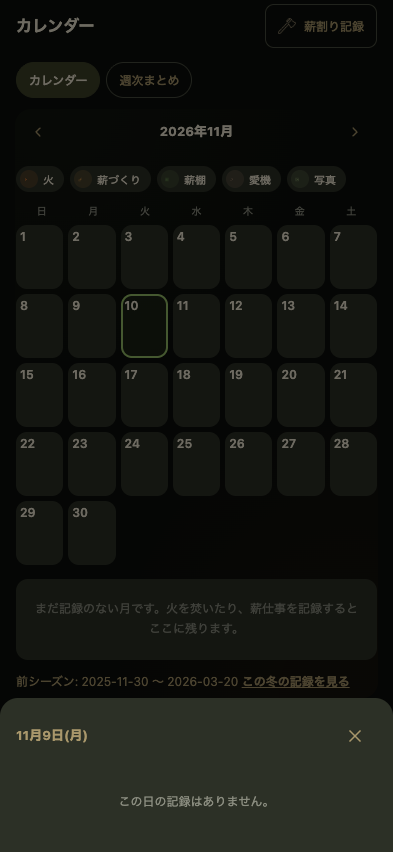
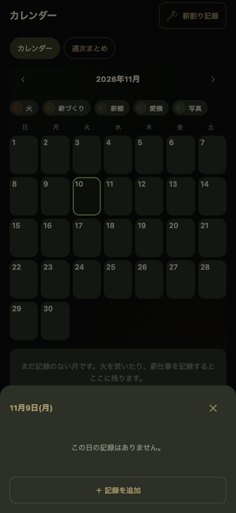

# 薪暮らしカレンダーから記録を追加する（v62）

2026-11-10。変更前: `d2ef09b`（v61）。既存のカレンダー、日別詳細、ホームの焚いた記録、薪割り・薪追加・棚チェック・手入れ・写真の入力と保存、週次/月次/シーズン集計を確認して判断した。

## 意見と判断

**追加に賛成。** カレンダーを眺めて思い出した作業や火の記憶を、その場で残せる。「昨日の薪割りを忘れていた」という具体的な目的に直接つながり、記録を振り返る楽しさを広げる。

変更前に実際に昨日の日付を開いたところ、空の日別画面には「この日の記録はありません。」だけで、追加できなかった。別画面の薪割り・手入れを開くと日付は今日になり、選んだ日を引き継げなかった。[操作結果](baseline.json)

月全体に追加ボタンやメニューは増やさず、日別画面に **「＋ 記録を追加」一つだけ** を置いた。種類は「火を焚いた」「薪割り」「お手入れ」の3択。日別の記録を見てから追加する構成とし、カレンダーの配色・アイコン・密度は保った。

この判断は開発側の評価であり、薪ストーブユーザーへの新たな観察テストやiPhone実機での確認は行っていない。

## 実際の使い方

1. カレンダーで昨日などの日付をタップ。
2. その日の内容を見て「＋ 記録を追加」。
3. 「薪割り」などを選ぶ。
4. 選んだ日付が入った入力画面で記録する。
5. 保存すると、その日の詳細に戻り、月のアイコンや集計にも反映される。

入力先で別の日付に変更した場合は、実際に保存した日の年・月・日へ戻る。過去の年は日別見出しにも年を表示する。キャンセルは入力画面→種類選択→日別詳細の順に戻り、保存しない。未来の日には追加ボタンを出さず、入力画面でも未来・空欄・存在しない日を保存しない。

## 実装と保存の関係

- **薪割り**: ホーム・週次まとめと同じ `openSplitLogSheet` を、初期日付と戻り先を渡して再利用。割った量または量不明を保存。棚の数量は変えない。カレンダーからは過去の作業記録に絞り、「棚に積んだ分へ」の分岐を出さない。
- **お手入れ**: 愛機と同じ `openMaintenanceSheet` を再利用。実施日・種類・メモ・写真を保存。写真の日付も実施日にそろい、アルバム・愛機・日別表示につながる。保存後だけ日別へ戻し、愛機から開く従来の履歴付き画面は維持。
- **火を焚いた日**: 従来はホームの即時保存と、保存後のひとこと入力のみだったため、日付・任意の薪棚・ひとことを指定できる共通シートを追加。ひとこと欄を既存の入力と共有し、保存はホームも新しいシートも `saveBurnRecord` に統一。棚が今は空でも、過去に焚いた事実を残せる。棚未登録なら指定せず記録できる。
- **重複**: 焚いた日は同じ日を増やさず、既存のひとことも勝手に上書きしない。同日・同量（量不明を含む）の薪割りは確認し、別の作業であることを選んだときだけ追加する。手入れは既存の同日・同種類の確認処理を継続。各保存は連打による重複も検証した。
- **初焚きとシーズン**: 既存のシーズン期間を優先。初焚きより前の記録を補った場合は、該当シーズンの開始日を前へ動かす。終了後の記録が補われた場合も範囲を整える。期間外の記録の補完では7月を冬の区切りとして使い、別の冬を混ぜない。昨冬などの新しい期間は終了済みとして作り、今季を勝手に開き直さない。同じ冬に複数の明示的な期間がある場合は既存期間を優先する。火の記録と期間の保存はまとめて行い、保存失敗時は巻き戻す。
- 新しいカレンダー専用の記録DBや、ホームと別の数量集計は作らない。既存のlocalStorageの記録を、既存の出来事アダプターと月次・週次・シーズン表示が読む。バックアップ形式も維持。
- PWAの版をv62に更新。月カレンダーの見た目を保ち、前回の入力欄のキーボード対策も継続。

## 対応を見送ったもの

| 記録 | 理由・現在の使い方 |
|---|---|
| 過去の薪棚チェック・残量 | 「その日に測った量」と「現在の量」を安全に区別する入力が必要。今回は現在の棚チェックと履歴の訂正を継続する。単純に過去日を渡して現在量を上書きしない |
| 過去の棚への薪追加 | 当時の追加分が、その後の目視残量・初期登録量に含まれるか判別が必要。カレンダーは作業の振り返りに絞り、棚に積む操作はホームから継続 |
| 独立した写真追加・焚いた日の写真 | 写真だけの追加を設けると、日付以外に棚や愛機・樹種との関連も選ぶ必要がある。まずは手入れに写真を添える導線を採用。既存の棚・愛機・樹種からの写真も引き続きアルバムへ集まる |
| 未来の実績・予定登録 | 実績と予定を混ぜないため。既存の煙突掃除予定は設定から利用できる |

## 検証

環境: macOS、Node.js 24、Playwright 1.62.1、Chrome 157.0.8103.40、日本時間。393×852、320×740、特大文字。入力の表示範囲を狭めるテストも実施。iPhone実機・iOSのIME/キーボードアニメーションは未確認。

| 検証 | 結果 |
|---|---|
| データ処理 | 33件成功（既存22＋今回11）。同日重複、棚の数量不変、初焚きの補完、昨冬・年末年始・7月境界、日付の不正、保存失敗時の巻戻し、集計、バックアップ往復 |
| カレンダー操作 | 13項目成功。日付引継ぎ、追加後に戻る日、取消、連打、同日同量の明示的追加、写真付き手入れ、アルバムから戻る、未来日・空欄、オフライン、うるう日、再読込、320px/特大文字 |
| 既存の主な操作 | 16項目成功。空ホーム、棚の登録・数量訂正、薪割りと棚への追加、焚いた日、写真、復元、124ログ、オフライン、文字拡大 |
| キーボード表示範囲 | 12項目成功。今回の焚いた日入力も含め、入力文字の見え方・日付/メモ・長いフォーム・横画面・再案内を確認。iPhoneキーボードを実操作したテストではない |
| 境界条件の操作 | 4項目成功。手入れの写真選択中の取消、破損JSON、天気取得失敗、年末の終了日集計 |
| 更新 | 6項目成功。v61→v62、失敗時の旧版保持、入力中の更新待機、記録・写真の引継ぎ、オフライン起動・記録 |
| コンソール | 予期しないエラー・未処理例外0件 |

結果: [カレンダー](calendar-results.json) / [通常操作](browser-results.json) / [キーボード](keyboard/results.json) / [境界条件](edge-results.json) / [更新](pwa-results.json)

## 画面

| 変更前の空の日 | 変更後の空の日 |
|---|---|
|  |  |

[種類の選択](after-picker.png) / [選んだ日の薪割り入力](after-split.png) / [追加後の日別表示](after-recorded-day.png) / [320px・特大文字](after-picker-large-text.png)

## iPhoneで試す

同じアプリURLを開き直し、更新案内が出たら入力を保存して更新する。設定の末尾がv62になったら、カレンダーの昨日→「＋ 記録を追加」→「薪割り」を選ぶ。日付が昨日になっていることを確認し、保存後に昨日の詳細・アイコンへ反映されることを見る。棚の数量が増えていないことも確認できる。

再実行: `npm test`、`npm run test:calendar`。一括検証は `node tests/run-calendar-regression.cjs`（既存Chromeは`CHROME_PATH`、Gitの指定は`GIT_PATH`）。
