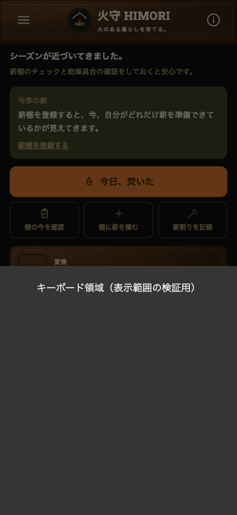
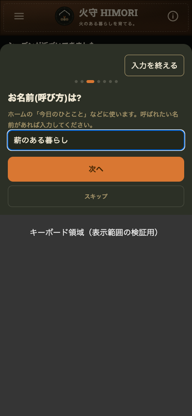

# v61: iPhoneのキーボードと入力欄の重なりを修正

2026-11-10。利用者のiPhone 16で、初回案内の名前・ストーブ名などがキーボードに隠れるという報告に対応。

## 原因と変更

従来は固定オーバーレイがキーボード表示前の画面下端に固定され、入力シートの最大高さも`vh`で指定されていた。表示領域だけが狭くなるiOSの条件に追従していなかった。

- `visualViewport.height`と`offsetTop`に合わせ、入力シートの高さと位置を更新。
- 入力欄が見える範囲からはみ出した時だけ、シートや通常画面内をスクロール。
- 棚チェックでは画面内のスクロール領域にキーボード分の余白を追加。末尾までスクロール済みでも入力を上へ移動できる。
- 文字・数値・日付・メモの入力文字を最低16pxにし、狭い画面で横にはみ出さないよう調整。ピンチ拡大は引き続き可能。
- キーボードを開いた入力シートに「入力を終える」を表示。閉じても文字は保持。
- 設定に「初回案内をもう一度見る」を追加。棚・写真・記録を消さずに名前入力を確認できる。
- PWAキャッシュと版表示をv61へ更新。

表示領域の基本的な仕組みは[MDN VisualViewport](https://developer.mozilla.org/en-US/docs/Web/API/VisualViewport)、iOSの更新イベントがキーボードのアニメーション完了時になる条件は[WebKitの記録](https://bugs.webkit.org/show_bug.cgi?id=265578)を参照。focus時の遅延再確認とresize/scrollイベントの両方で追従する。

## 実施した検証

Chrome 157.0.8103.40、Playwright、393×852を基本に、表示範囲の高さ440/400/360/320/230px、表示範囲の上端移動100px、横画面852×393、特大文字。

**実際のiPhoneキーボードを自動操作した検証ではない。** レイアウトの高さを保ったままVisualViewportだけを縮小・移動させる再現テストであり、IME候補欄、iOSのキーボードアニメーション、Safari/ホーム画面版の差は実機で最終確認が必要。

`tests/keyboard.cjs`の11項目が成功:

1. v60の名前欄がキーボード領域に入る条件を再現し、v61では入力欄が見えることを確認。
2. ストーブ名と郵便番号。
3. 新しい棚の名前・容量・乾燥開始日。
4. 薪追加の日付・樹種・入手先・価格・メモ。
5. 愛機の名前・購入日・触媒交換日。
6. 手入れの日付・メモ。
7. 樹種名・メモ。
8. シート以外の棚チェックのメモ。
9. 長いフォーム・特大文字・キーボードを閉じた後の入力保持。
10. 横画面で末尾の入力欄へ到達。
11. 設定から初回案内を再表示し、棚を保持したまま名前入力。

通常操作の回帰テスト16項目も成功。保存・訂正・取消・写真・124ログ・復元・オフライン・320px/特大文字を確認。予期しないコンソールエラー・未処理例外0件。

PWA更新テスト6項目成功。v60→v61、資産取得失敗時の保護、入力中の更新待機、記録と写真の引継ぎ、オフライン再起動と保存、同じ版の資産配信を確認。データ処理22件のテストも成功。

[表示テスト結果](results.json) / [通常操作](browser-results.json) / [更新](pwa-results.json)

## 比較画像

灰色は検証用に重ねたキーボード領域で、iPhoneの実キーボード画像ではない。

| 修正前 | 修正後 |
|---|---|
|  |  |

[薪の追加メモの表示確認](after-add-memo.png)

## iPhoneでの再確認

1. 同じ確認用アプリを開く。更新案内が出たら入力を保存して「保存を終えたので更新」を押す。
2. メニュー→設定の末尾で「v61」を確認。
3. 「初回案内をもう一度見る」→「はじめる」→名前欄に入力。入力文字がキーボードの上に見えることを確認。
4. 「入力を終える」で閉じ、文字が残ることを確認。ストーブ名・郵便番号でも確認。
5. 棚の名前、薪追加のメモ、手入れのメモを入力。横向きや特大文字でも入力先と文字が見えることを確認。

これまでの記録を消す操作は今回追加・実施していない。利用者が消去を許可したことは承知した上で、入力表示の修正に消去が不要だったため現状を維持した。
